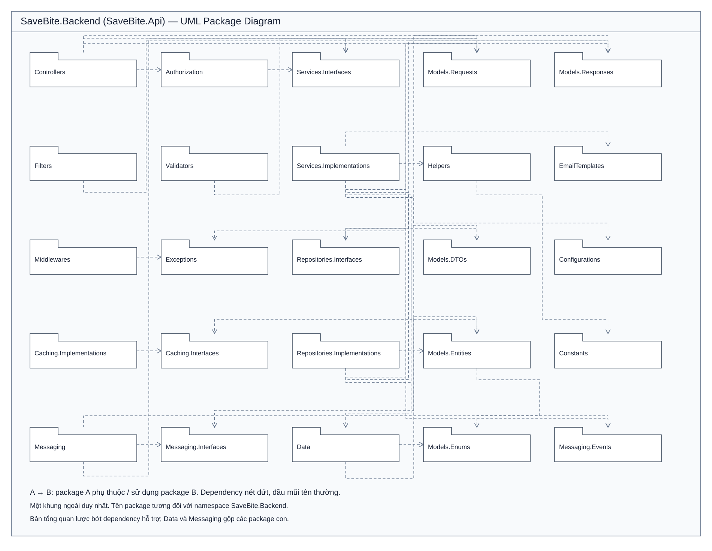

# Backend Package Diagram — một khung ngoài

- [Mở/chỉnh sửa bằng draw.io](backend-package-diagram.drawio)
- [XML draw.io không nén](backend-package-diagram.drawio.xml)
- [SVG](backend-package-diagram.svg)
- [PlantUML](backend-package-diagram.puml)

Chỉ có một container ngoài: SaveBite.Backend (SaveBite.Api). Tất cả package được đặt trực tiếp trong khung này, không chia thành các layer con. Sơ đồ giữ 25 package và 35 dependency chính đã có trong sơ đồ đối chiếu mã nguồn trước đó; lược bớt cạnh hỗ trợ để giảm độ rối. Các quan hệ là dependency, không dùng realization.

Data gộp AppDbContext, Configurations, Migrations, Seed. Messaging gộp Publisher, Consumer, Extensions, Configuration, Constants, Models; Interfaces/Events được tách riêng. Services.Interfaces chứa cả interface nghiệp vụ và hạ tầng hiện có.

Trong draw.io, chọn File → Open From → Device rồi mở file .drawio hoặc .drawio.xml. XML không nén chứa mxGraphModel; các package và dependency là đối tượng riêng có thể chỉnh sửa, không phải ảnh nhúng. SVG, PlantUML và draw.io dùng cùng 35 cạnh. Đã kiểm tra XML/SVG hợp lệ, ID/source/target đầy đủ và mọi package cùng thuộc container backend; chưa mở thử trong ứng dụng draw.io tại môi trường này.
