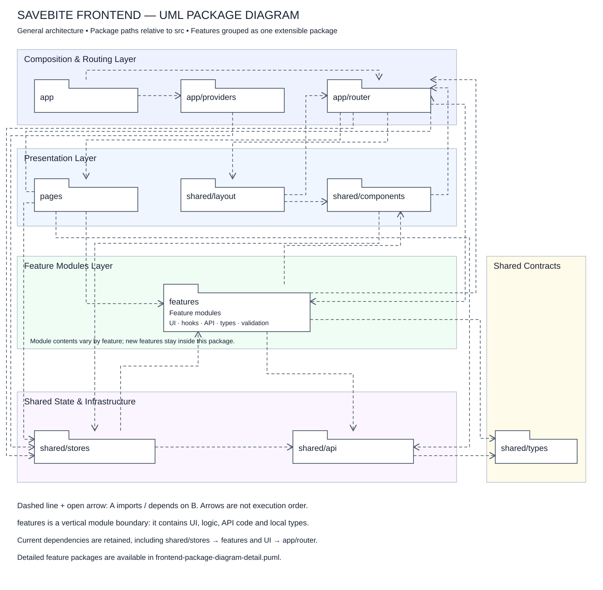

# Frontend Package Diagram — Tổng quan mở rộng theo feature

[Tải SVG](frontend-package-diagram.svg) · [PlantUML tổng quan](frontend-package-diagram.puml) · [PlantUML chi tiết hiện tại](frontend-package-diagram-detail.puml)

Sơ đồ tổng quan gộp toàn bộ module trong `src/features` thành package **features**. Khi thêm tính năng, module mới nằm trong khung này; không cần thêm riêng mỗi chức năng vào sơ đồ kiến trúc tổng quan. Các module có thể chứa pages, components, hooks, api, types, schemas hoặc utils tùy nhu cầu; không giả định mọi module có đủ thư mục.

Các layer được bao khung theo trách nhiệm: Composition & Routing, Presentation, Feature Modules, Shared State & Infrastructure, Shared Contracts. Features là nhóm module theo chiều dọc, có cả UI, logic và truy cập API; không chỉ là business logic. Các đường dẫn khác giữ nguyên: app/providers, app/router, pages, shared/layout, shared/components, shared/stores, shared/api, shared/types.

Mũi tên nét đứt đầu thường A → B biểu diễn import/re-export/type dependency. Các cạnh được gộp từ import đã đối chiếu trong code; không thêm tính năng dự kiến chưa tồn tại. Sơ đồ không dùng realization. Có phụ thuộc hai chiều giữa UI/features và app/router vì route import page còn page/component import paths. shared/stores hiện import Auth API/types từ features nên vẫn giữ shared/stores → features.

Bản tổng quan thể hiện 22 dependency sau khi gộp. [Căn cứ từng cạnh tổng quan](frontend-package-overview-dependencies.json) giữ các file/import thực tế. [Căn cứ bản chi tiết](frontend-package-dependencies.json) giữ 44 dependency trước khi gộp. SVG và PlantUML tổng quan dùng cùng tập cạnh; đã kiểm tra SVG XML và đối chiếu các cạnh. Bản PlantUML chi tiết giữ nguyên để tham khảo cấu trúc Auth/Products đang triển khai.

## XML draw.io

[File draw.io](frontend-package-diagram.drawio) · [XML không nén](frontend-package-diagram.drawio.xml). Trong draw.io chọn File → Open From → Device. Mỗi package, khung layer và dependency là đối tượng có thể chỉnh sửa riêng. Bố cục giữ theo SVG tổng quan, có package features chung. Đã kiểm tra XML hợp lệ và 22 cạnh trùng bản PlantUML; chưa mở thử trong UI draw.io.
