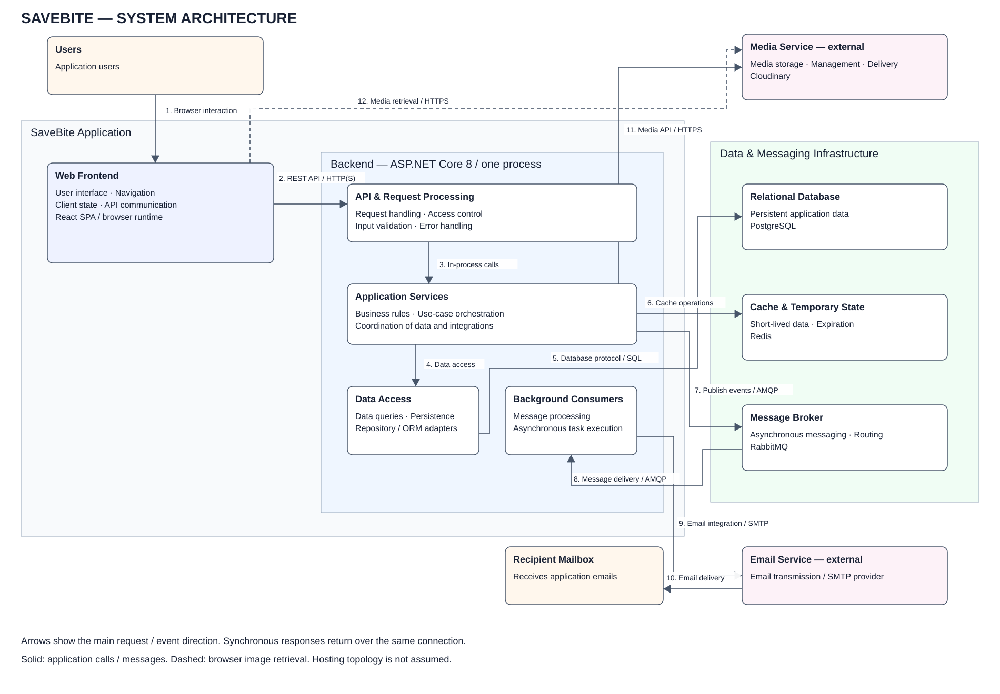

# System Architecture — SaveBite

## Sơ đồ tổng thể

[SVG](system-architecture.svg) · [draw.io chỉnh sửa được](system-architecture.drawio) · [XML draw.io không nén](system-architecture.drawio.xml)

Sơ đồ mô tả kiến trúc runtime từ mã nguồn hiện có ngày 06/10/2026. SaveBite gồm frontend React chạy trong trình duyệt và một backend ASP.NET Core 8. Backend sử dụng PostgreSQL, Redis, RabbitMQ và tích hợp Cloudinary/SMTP. Các khối bên trong backend là module trong cùng một tiến trình, không phải microservices độc lập.

Mũi tên thể hiện hướng gọi chính hoặc truyền sự kiện; response của lời gọi đồng bộ quay lại trên cùng kết nối. Khác với package diagram, đây là kết nối runtime, không phải import/dependency. Đường nét đứt biểu diễn trình duyệt tải ảnh từ URL bên ngoài.

## Giải thích các thành phần

Các nhãn mô tả trách nhiệm kiến trúc chung, không giới hạn vào một tính năng hay loại consumer. Công nghệ hiện dùng được ghi riêng để giữ sơ đồ có căn cứ trong hệ thống thực tế.

| Thành phần | Trách nhiệm tổng quát |
|---|---|
| Users | Người dùng tương tác với hệ thống qua giao diện. |
| Web Frontend | Hiển thị giao diện, điều hướng, quản lý trạng thái phía client và giao tiếp API; hiện là React SPA. |
| API & Request Processing | Tiếp nhận request, kiểm soát truy cập, kiểm tra đầu vào, trả response và xử lý lỗi. |
| Application Services | Thực thi quy tắc nghiệp vụ, điều phối use case, dữ liệu và các tích hợp. |
| Data Access | Cung cấp truy vấn và lưu trữ dữ liệu qua repository/ORM adapter. |
| Background Consumers | Nhận và xử lý thông điệp, thực thi tác vụ bất đồng bộ. Đại diện cho tập consumer mở rộng theo nhu cầu. |
| Relational Database | Lưu trữ dữ liệu ứng dụng bền vững và đảm bảo các ràng buộc quan hệ; hiện sử dụng PostgreSQL. |
| Cache & Temporary State | Lưu dữ liệu ngắn hạn và trạng thái có thời hạn; hiện sử dụng Redis. Không khẳng định mọi truy vấn nghiệp vụ đang được cache. |
| Message Broker | Truyền và định tuyến thông điệp giữa producer và consumer; hiện sử dụng RabbitMQ. |
| Media Service | Lưu trữ, quản lý và phân phối media; tích hợp hiện tại là Cloudinary. |
| Email Service | Tiếp nhận và truyền email qua nhà cung cấp SMTP. Đây là một hệ thống ngoài cụ thể, không giới hạn nội dung email ở OTP. |
| Recipient Mailbox | Điểm nhận email do hệ thống gửi. |

## Kết nối giữa các thành phần

| Số trên hình | Kết nối | Giao thức / nội dung |
|---|---|---|
| 1 | Users → Frontend | Thao tác trên giao diện trình duyệt. |
| 2 | Frontend → API & Request Processing | HTTP(S) REST; JSON cho dữ liệu, multipart/form-data cho upload ảnh. Endpoint được bảo vệ nhận Authorization: Bearer JWT; các endpoint anonymous không yêu cầu JWT. |
| 3 | API & Request Processing → Application Services | Lời gọi phương thức trong cùng tiến trình qua DI. |
| 4 | Application Services → Data Access | Gọi repository để đọc/ghi dữ liệu. |
| 5 | Data Access → Relational Database | EF Core/Npgsql gửi truy vấn qua PostgreSQL protocol. |
| 6 | Application Services → Cache & Temporary State | Redis commands qua StackExchange.Redis, bao gồm TTL/counter và thao tác nguyên tử. |
| 7 | Application Services → Message Broker | Publish sự kiện bằng AMQP/RabbitMQ.Client; EmailNotificationEvent là ví dụ hiện đã triển khai. |
| 8 | Message Broker → Background Consumers | Broker định tuyến message tới queue; consumer tương ứng nhận và xử lý. Mỗi nhóm chức năng có thể có consumer/queue riêng; consumer của cùng queue chia sẻ công việc. Base consumer hiện ACK khi thành công, NACK với requeue=false khi lỗi. |
| 9 | Nhánh email trong Background Consumers → Email Service | Chỉ EmailConsumer gọi SMTP adapter; các consumer khác không mặc định sử dụng SMTP. STARTTLS được chọn khi Email.UseSsl bật, otherwise không chọn secure socket. |
| 10 | Email Service → Recipient Mailbox | Giao email theo hạ tầng nhà cung cấp, ngoài phạm vi SaveBite. |
| 11 | Application Services → Media Service | Adapter gọi API upload/xóa ảnh. URL/public ID trả lại và được lưu qua repository. |
| 12 | Web Frontend → Media Service | Trình duyệt fetch ảnh từ URL được hiển thị trong img. Đây là kết nối lấy media, không phải browser gọi API upload có secret. |

## Mở rộng xử lý bất đồng bộ

Khối **Background Consumers** đại diện cho tập consumer, không phải một consumer duy nhất. Khi thêm sự kiện mới, bổ sung handler/consumer và cấu hình routing/queue phù hợp bên trong phân hệ này; sơ đồ tổng quan giữ nguyên. Nếu nhiều chức năng cần nhận cùng một sự kiện độc lập, định tuyến tới các queue riêng. Nhiều consumer cùng một queue chủ yếu chia sẻ công việc, không đảm bảo mỗi consumer đều nhận một bản sao của sự kiện.

EmailConsumer là một ví dụ hiện có. Cạnh tới dịch vụ email được ghi rõ **Email integration**; không áp dụng cho mọi consumer. Các handler mới có thể gọi nghiệp vụ hoặc adapter tương ứng khi được triển khai; sơ đồ chưa thêm kết nối giả định tới hệ thống ngoài mới. Cách triển khai nhóm consumers trong cùng backend hiện tại không ngăn việc tách worker riêng sau này, nhưng sự thay đổi topology đó cần cập nhật sơ đồ khi thực hiện.

## Ví dụ triển khai hiện tại (không giới hạn kiến trúc)

**Đăng ký:** browser gửi request → API/validation → AuthService kiểm tra PostgreSQL, lưu pending/password hash và OTP hash vào Redis → publish sự kiện RabbitMQ → consumer nền gửi SMTP → inbox. Người dùng nhập OTP; backend xác minh/consume trong Redis rồi tạo user trong PostgreSQL. Đăng nhập là bước riêng.

**Đăng nhập/refresh:** frontend gọi API, backend kiểm tra account/password và tạo JWT cùng refresh token. Hash refresh token lưu trong PostgreSQL; frontend giữ token qua localStorage. Axios gắn bearer token và thực hiện refresh/retry khi phù hợp. Không có identity provider bên ngoài trong luồng hiện tại.

**Sản phẩm có ảnh:** browser gửi multipart tới backend → kiểm tra quyền chủ shop và dữ liệu → Cloudinary upload → repository lưu aggregate cùng metadata/URL trong PostgreSQL → API trả response → browser tải ảnh qua URL. Nếu upload/lưu thất bại, service cố dọn ảnh mới đã upload; Cloudinary và PostgreSQL không có transaction chung.

## Phạm vi và triển khai

Compose hiện định nghĩa PostgreSQL, Redis, RabbitMQ và volume cho các dịch vụ đó. Không định nghĩa frontend/backend service trong compose. Vì vậy các khung trong sơ đồ không khẳng định chúng đang cùng host/container hay đã được deploy lên cloud. Source chưa cung cấp topology production cho web hosting, reverse proxy hoặc load balancer nên không thêm các thành phần này.

HTTP(S) trên hình biểu diễn kết nối API. Frontend .env.example hiện là HTTP localhost, trong khi backend có UseHttpsRedirection; điểm kết thúc TLS phụ thuộc môi trường chạy thực tế. Các cổng mặc định trong compose: PostgreSQL 5432, Redis 6379, RabbitMQ AMQP 5672; management UI 15672 phục vụ vận hành và được lược khỏi sơ đồ nghiệp vụ.

Không thêm payment gateway, shipping provider, identity provider hoặc các microservice Orders/Payments vào kiến trúc đang triển khai chỉ vì có entity liên quan. Khi triển khai tích hợp mới, cập nhật sơ đồ và bảng giải thích theo kết nối thực tế.

## Căn cứ mã nguồn và kiểm tra

- Frontend: src/main.tsx, src/app/providers/AppProvider.tsx, src/shared/stores/authStore.ts, src/shared/api/httpClient.ts, src/features/products/api/productApi.ts, các components hiển thị ảnh.
- Backend: SaveBite.Api/Program.cs, Extensions/ServiceExtensions.cs, Extensions/DatabaseExtensions.cs, Extensions/RedisExtensions.cs, Services/Implementations/AuthService.cs, ProductService.cs, CloudinaryService.cs, SmtpEmailService.cs.
- Messaging: Messaging/Extensions/RabbitMqConsumerRegistration.cs, Messaging/Consumer/Email/EmailConsumer.cs, RabbitMqHostedService.cs, RabbitMqConsumer.cs, Publisher/RabbitMqPublisher.cs.
- Hạ tầng: SaveBite.Backend/compose.yaml, SaveBite.Api/SaveBite.Api.csproj và các file .env.example (chỉ đọc template, không đọc secret thực tế).

SVG và XML draw.io chứa cùng 12 thành phần và 12 kết nối. Đã kiểm tra XML hợp lệ, ID và source/target của mỗi cạnh. Các khối và đường nối draw.io là đối tượng riêng chỉnh sửa được; chưa mở thử trong UI draw.io. Trong draw.io chọn File → Open From → Device để mở file .drawio hoặc .drawio.xml.
